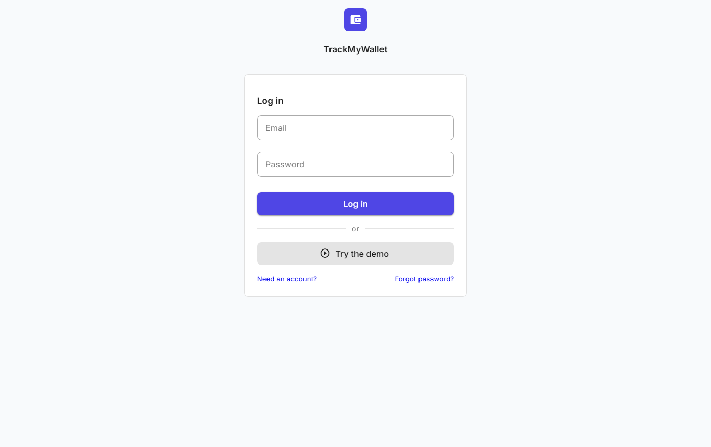
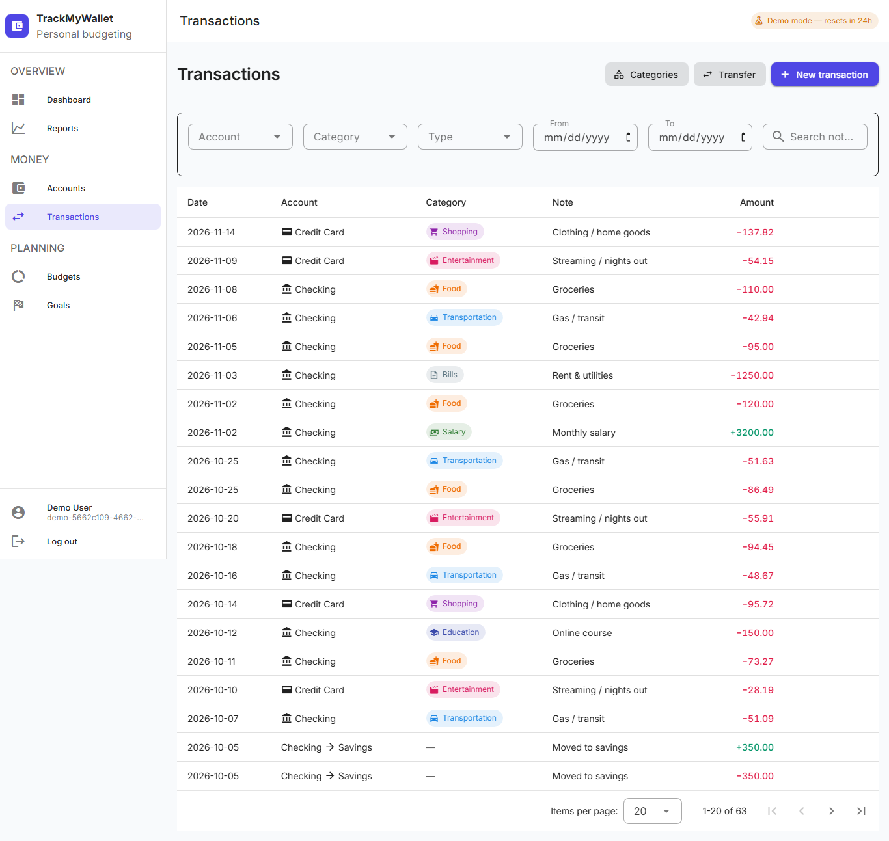
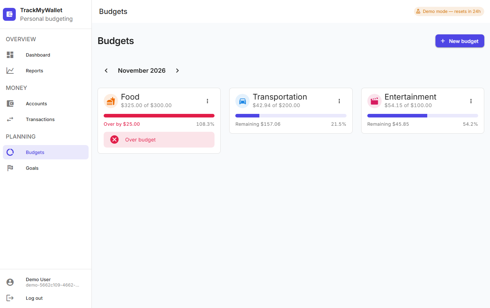
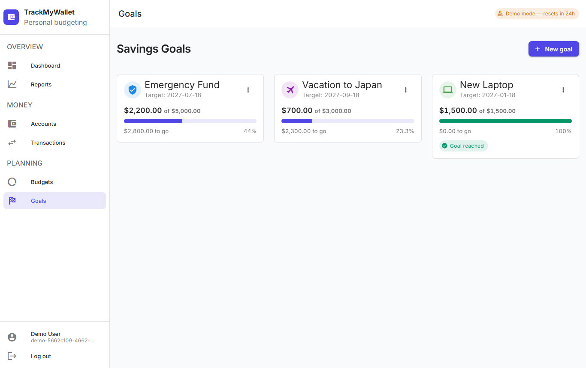
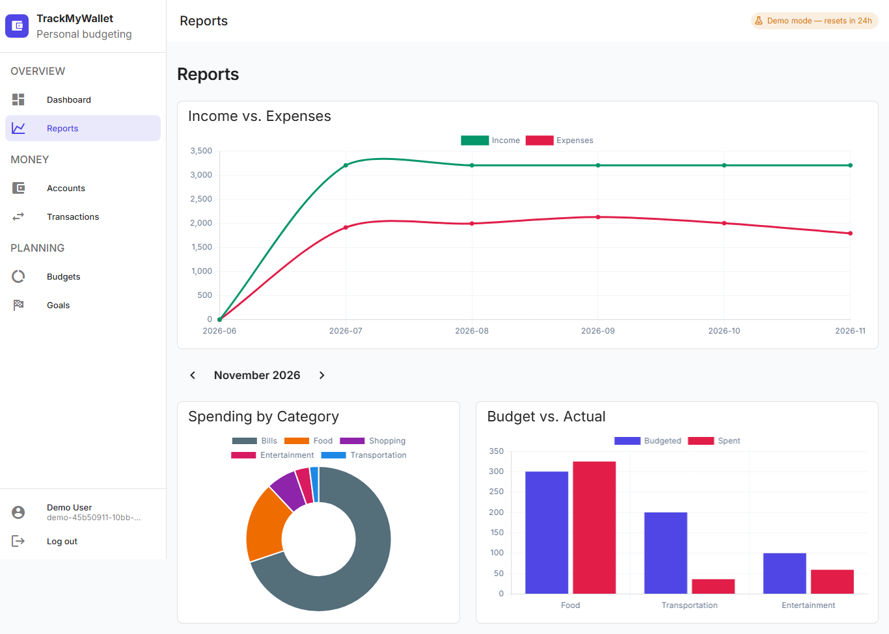

# TrackMyWallet — Web App

The Vue 3 SPA for [TrackMyWallet](https://trackmywallet.org), a personal finance app for tracking accounts, transactions, budgets, and savings goals. This repo is the frontend half; the Laravel API it talks to lives in [`personal-wallet-backend`](https://github.com/nadimelchammaii-hash/personal-wallet-backend).

**Live demo: [trackmywallet.org](https://trackmywallet.org)** — click **Try the demo** on the login page for an instant, pre-populated account. No sign-up required.



## What it does

- **Dashboard** — balance, this month's income/expenses/savings, remaining budget, recent transactions, and spending by category at a glance.
- **Accounts** — cash, bank, credit card, and savings accounts with running balances.
- **Transactions** — add income/expenses by category, transfer between your own accounts, filter by account/category/type/date, search by note.
- **Budgets** — a monthly cap per category with a progress bar and an over-budget warning.
- **Goals** — savings goals with a target amount/date, funded by logged contributions.
- **Reports** — income vs. expenses over time, spending by category, and budget vs. actual, charted with Chart.js.



## The live demo

The login page's **Try the demo** button logs you straight into a brand-new, fully isolated demo account — not a shared one, so nothing you do affects anyone else's session. It comes pre-populated with ~5 months of realistic transaction history so the Dashboard and Reports pages actually have something to show, including budgets tuned to land in a believable mix of over/under for the current month:




A **Demo mode — resets in 24h** badge stays visible in the app bar for the whole session, and the Profile page disables name/email/password changes for demo accounts (enforced on both ends — the UI disables the fields, and the API rejects the request either way).



## Stack

- **Vue 3** (Composition API) + **Vite**
- **Vuetify 4** — Material-based component library, themed (light/dark, user-togglable) rather than left at defaults
- **TypeScript**
- **Pinia** for state — one store per domain (`auth`, `accounts`, `transactions`, `budgets`, `goals`, `reports`, `dashboard`)
- **Vue Router**
- **Chart.js** + **vue-chartjs** for the Reports charts
- **ESLint** (`eslint-config-vuetify`) + `vue-tsc` for linting/type-checking

## How it works

- **Sanctum SPA auth, not tokens.** The app authenticates via Laravel Sanctum's cookie-based SPA flow: a CSRF cookie is fetched once, then every mutating request carries it as a header. There's no bearer token to manage — the browser's session cookie *is* the auth state, which is also why login/register/demo-login all return the same `UserResource` shape and the rest of the app never has to special-case how a session started.
- **One Pinia store per resource**, each owning its own fetch/create/update/delete calls against the API and exposing plain reactive state — no Vuex-style mutation boilerplate.
- **Feature-folder structure.** `src/features/<domain>/pages` and `.../components` per domain (accounts, transactions, budgets, goals, reports, dashboard, auth, profile), rather than grouping everything by file type.
- **A themed design system, not Vuetify defaults.** Colors, density, and component defaults are set centrally in `src/plugins/vuetify.ts` (see `walletLight`/`walletDark`), so every page inherits the same look rather than each component picking its own styling.
- **Caddy serves the production build and reverse-proxies the API.** In production, this SPA and the Laravel API share one origin — Caddy (configured in `Caddyfile`) serves the built static files and routes `/api/*` and `/sanctum/*` straight to the backend, so there's no CORS to configure. `index.html` is served with `Cache-Control: no-cache` so returning visitors never get stuck on a stale build, while hashed files under `/assets/*` get a one-year immutable cache.

## Getting started

The easiest way to run the full stack (this app + the API + MySQL + phpMyAdmin) is `docker-compose.yml` in the [`personal-wallet-backend`](https://github.com/nadimelchammaii-hash/personal-wallet-backend) repo — it builds this app from a sibling checkout, so clone both repos side by side and run `docker compose up` from there. To run just this app standalone against an already-running API:

```bash
npm install
npm run dev
```

Set `VITE_API_BASE_URL` (see `.env.example`) to point at your backend.

### Scripts

```bash
npm run dev          # Vite dev server
npm run build         # type-check + production build
npm run lint          # ESLint
npm run type-check    # vue-tsc
```

## Deployment

Production builds to static files (`vite build`) and serves them from a `caddy:2-alpine` image (`Dockerfile.prod` + `Caddyfile`), which also reverse-proxies the API — see `docker-compose.prod.yml` in the [`personal-wallet-backend`](https://github.com/nadimelchammaii-hash/personal-wallet-backend) repo for the full three-container (`mysql`, `backend`, `frontend`) setup.
